# АБС-Миграция — платформа миграции банковских данных

АРМ системного аналитика для перевода данных из legacy-АБС («Гефест», «ПрограмБанк», «Инверсия», «ВаБанк»)
в ЦФТ-Банк (IBSO): карта данных, качество, сверка остатков, правила трансформации, проводки,
cut-over, ассистент по регламентам и контроль готовности.

Оконный интерфейс + микросервисный бэкенд на FastAPI, данные в SQLite `mig.db`.
`2 102` теста, `ruff` без замечаний.


## Прогресс волны: cut-over → запуск → SSE-прогресс → журнал

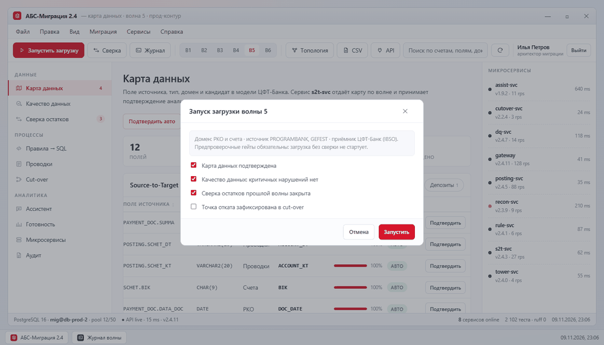

## Вход и переход к работе

Роли выбираются плитками, учётные данные проверяет сервер, пароль не сохраняется в браузере.
Пока идёт подключение к API и загрузка восьми источников, поверх окна висит оверлей с этапами
(«подключаюсь к API» → «загружаю данные»); если сервис не ответил, показывается тост и приложение
остаётся в демо-режиме.

| Экран входа | Загрузка данных |
| --- | --- |
| 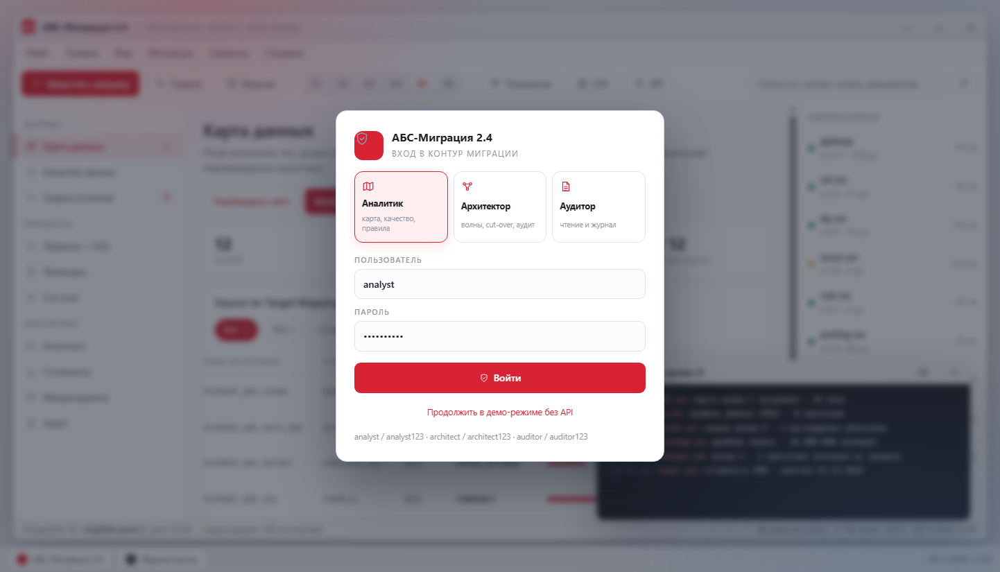 | 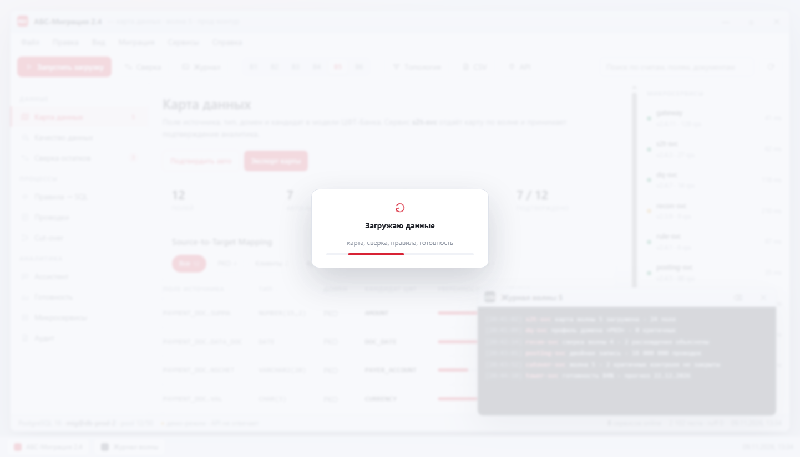 |

Иконки навигации, тулбара и кнопок — собственный SVG-спрайт (`<symbol>` + `<use>`), без внешних шрифтов
и картинок: они наследуют цвет текста, масштабируются без потерь и не дают пустых квадратов при офлайн-загрузке.

## Экраны

| Экран | Что делает | Скриншот |
| --- | --- | --- |
| Карта данных (S2T) | авто-мэтч полей legacy → ЦФТ, подтверждение пар, фильтры по доменам | 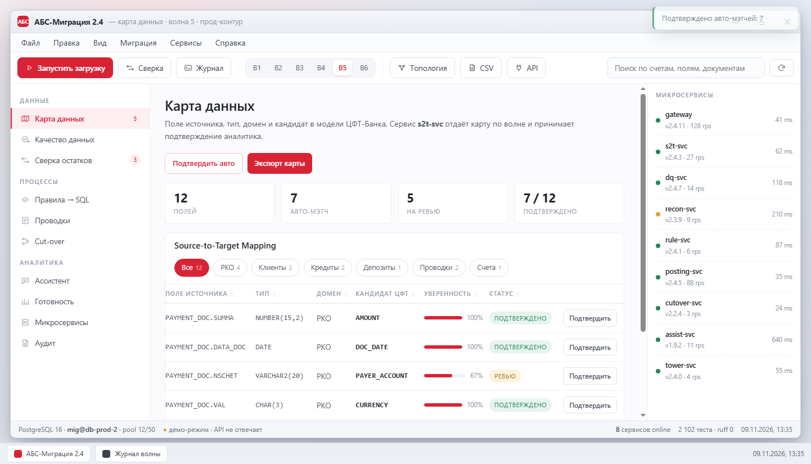 |
| Качество данных | контроль ИНН/БИК/счёта, красное сальдо, дубли — 5 правил профиля | 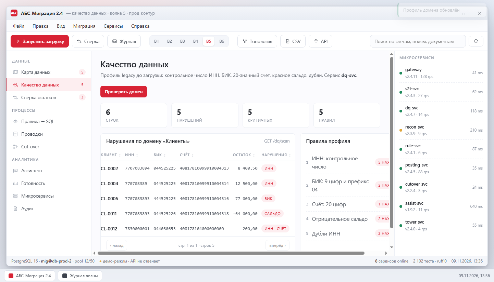 |
| Сверка остатков | сальдо legacy vs ЦФТ по счёту и валюте, причина каждой разницы | 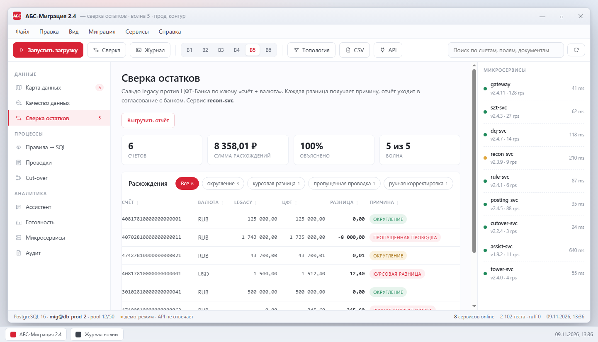 |
| Правила → SQL | реестр правил, редактор, SQL-черновик и граничные случаи | 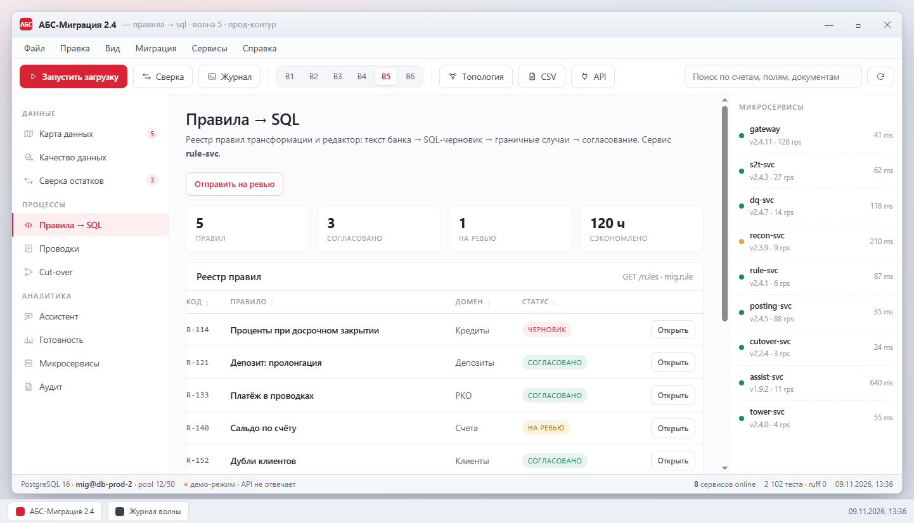 |
| Проводки | двойная запись, разбаланс, хронология и документы задним числом | 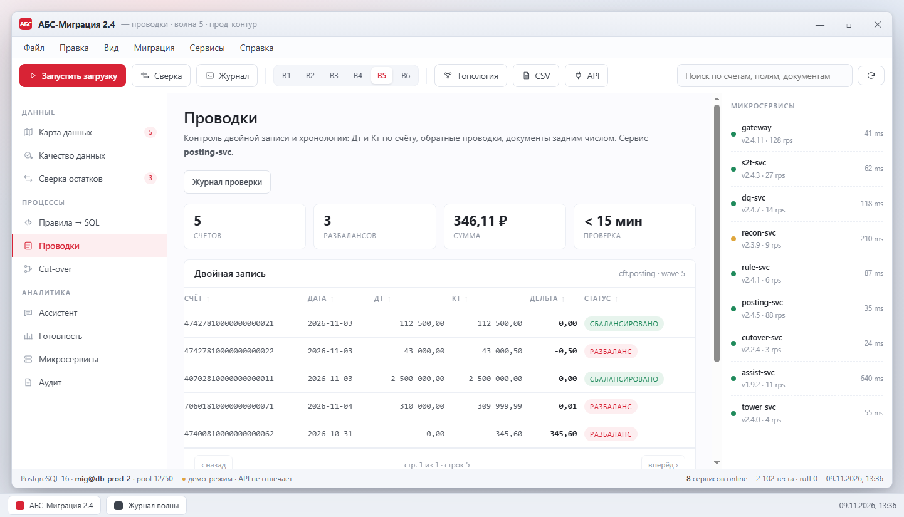 |
| Cut-over | контроли процесса, покрытие, блокировка даты при незакрытом откате | 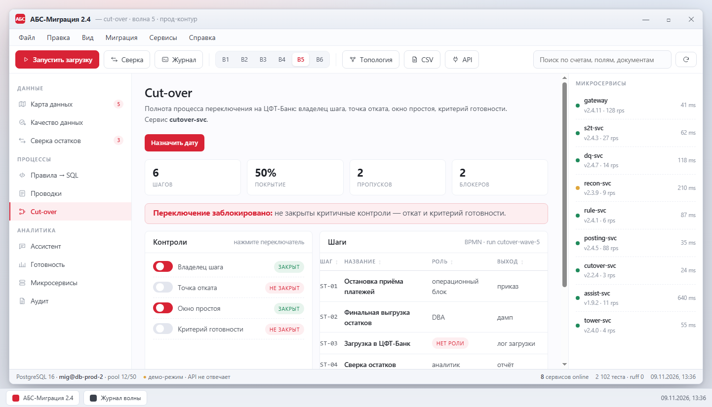 |
| Ассистент | ответы по регламентам со ссылкой на документ, отказ без источника | 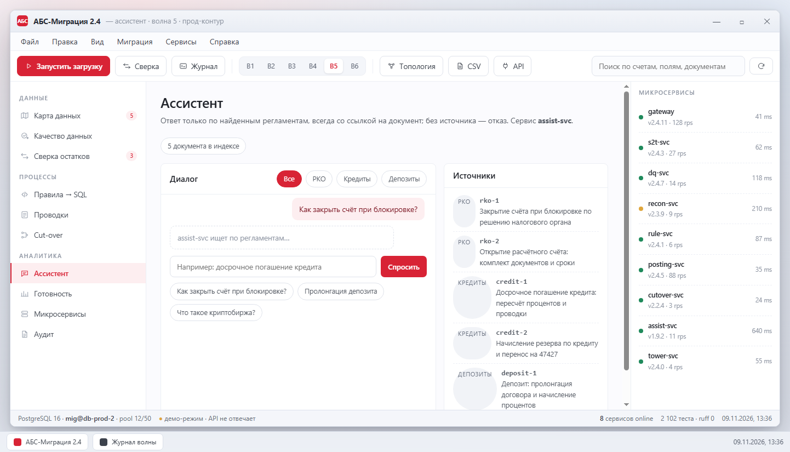 |
| Готовность | риск-скоринг доменов, прогресс волн, прогноз даты | 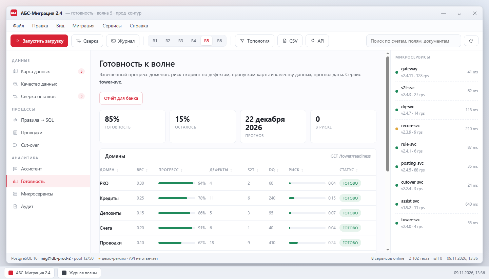 |
| Микросервисы | топология, health, версии, API-контракты | 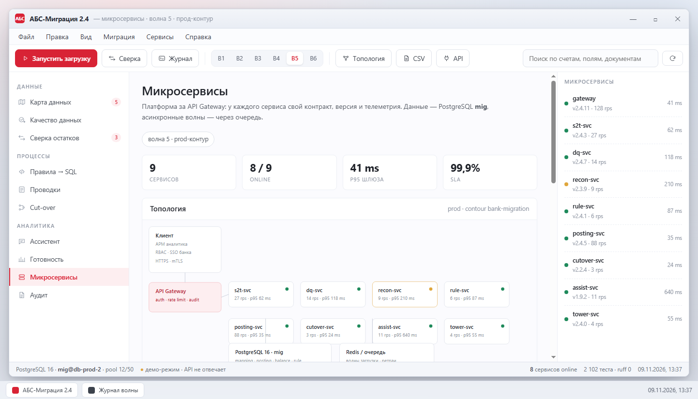 |
| Аудит | журнал действий: пользователь, сервис, объект | 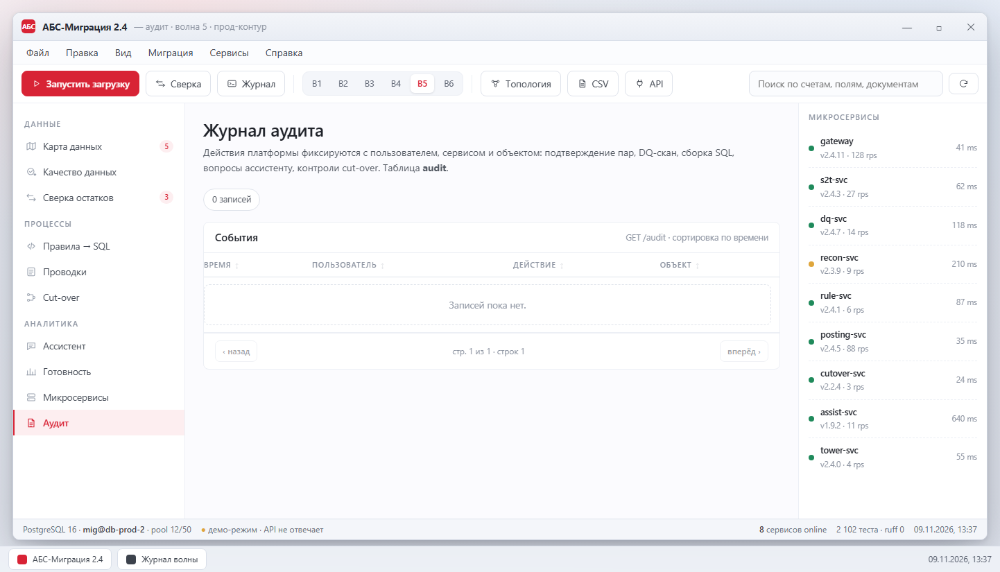 |
| Запуск волны | предпроверочные гейты перед загрузкой | 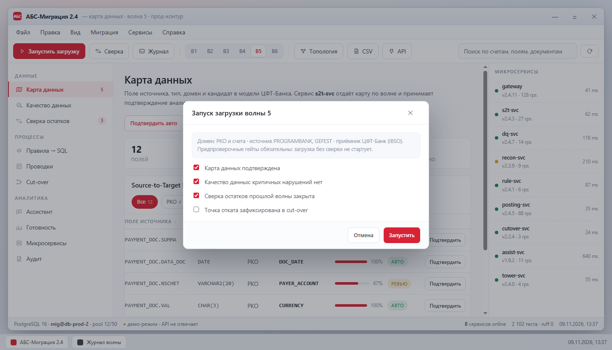 |
| Прогресс и журнал | полоса задачи в статус-баре, события сервисов | 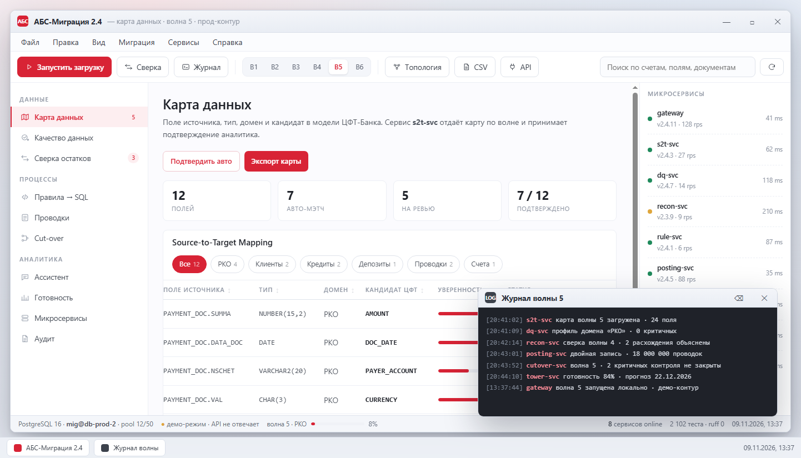 |

## Архитектура

```
Клиент (АРМ, окно приложения)
        │  HTTPS · mTLS · RBAC
   API Gateway  ── auth · rate limit · audit
        │
 ├── s2t-svc        карта полей и подтверждение
 ├── dq-svc         профиль домена до загрузки
 ├── recon-svc      сальдо legacy vs ЦФТ
 ├── rule-svc       правило → SQL-черновик
 ├── posting-svc    двойная запись и хронология
 ├── cutover-svc    полнота процесса переключения
 ├── assist-svc     вопросы по регламентам
 └── tower-svc      готовность и прогноз
        │
   PostgreSQL / SQLite `mig`  +  очередь волн (Redis)
        │
   ЦФТ-Банк (IBSO) — приёмник данных
```

Бэкенд: FastAPI поверх SQLite, логика вынесена в протестированные модули `bank-cases/cases/`
(ИНН с контрольным числом, реконсиляция, двойная запись, BPMN-полнота, RAG, риск-скоринг).

## Запуск

```cmd
cd bank-cases
run-api.cmd
```

или

```cmd
cd bank-cases
python -m uvicorn api.main:app --host 127.0.0.1 --port 8000
```

- приложение: <http://127.0.0.1:8000/app>
- OpenAPI: <http://127.0.0.1:8000/docs>
- живость: <http://127.0.0.1:8000/api/v1/health>

Без запущенного API файл `abs-migration-desktop.html` открывается в демо-режиме
на встроенных данных: интерфейс остаётся рабочим, в статус-баре горит «демо-режим».

## Роли

| Учётка | Пароль | Роль | Права |
| --- | --- | --- | --- |
| `analyst` | `analyst123` | системный аналитик | подтверждение пар, DQ-скан, правила, ассистент |
| `architect` | `architect123` | архитектор миграции | всё выше + контроли cut-over, дата, запуск волны, аудит |
| `auditor` | `auditor123` | аудитор | чтение, экспорт CSV, журнал аудита |

RBAC проверяется на сервере: без токена — `401`, без права — `403`. Кнопки без прав блокируются в интерфейсе.

## Качество

```cmd
cd bank-cases
python -m pytest -q                                  :: 2 102 passed
python -m ruff check api cases tests conftest.py      :: All checks passed
```

Интерфейс проверяется браузерным верификатором: 1440 и 390 px, сценарии навигации,
модалки, сортировки, фильтров и чата.

## Структура

```
abs-migration-desktop.html     окно приложения: вход по ролям, 10 экранов, SSE, RBAC, CSV
portfolio-system-analyst.html  портфолио-страница кейсов
docs/                          GIF-демонстрации и скриншоты экранов
bank-cases/
  api/                         FastAPI, SQLite mig.db, сиды, аудит, SSE
  cases/                       логика 8 кейсов (s2t, dq, reconcile, rules, postings, cutover, rag, tower)
  tests/                       2 102 параметризованных теста
  ruff.toml, pytest.ini, run-api.cmd, README.md
```

## Ограничения

- Вместо PostgreSQL/Oracle используется SQLite — на машине нет сервера БД; схема и SQL совместимы по смыслу.
- ИИ-слой работает на детерминированных эмбеддингах и правилах, без внешней LLM — офлайн-воспроизводимость важнее «магии».
- Скриншоты и GIF сняты в демо-режиме браузерным верификатором (сеть в нём отключена), поэтому в статус-баре видно «демо-режим».
